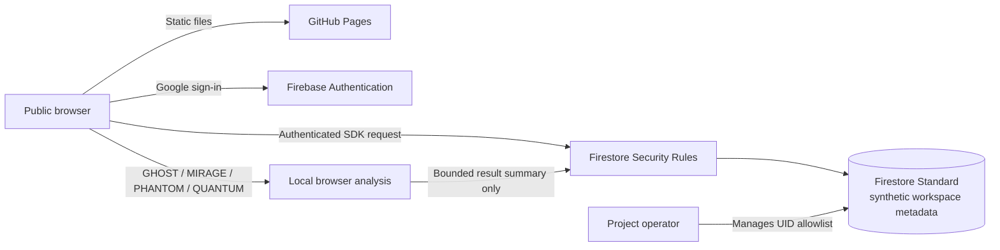

# OBSCURA Phase 3 — System Architecture and Threat Model

**Status:** Approved implementation design for the synthetic Firebase pilot; production-data policy remains pending · **Date:** 2026-11-15
**Depends on:** [Phase 2 Product and Safety Requirements](../product/phase-2-product-and-safety-requirements.md)
**Implementation plan:** [Firebase Phase 1–10 design](../superpowers/specs/2026-11-15-firebase-phase-1-to-10-design.md)

## 1. Scope and current state

This architecture supports a static React/Vite frontend with optional Firebase Authentication and Firestore for a small, invite-only, synthetic-data pilot. It does not add a privileged backend, file storage, external feeds, model APIs, or background jobs. The selected design does not provision or change a Firebase project. Firebase functionality remains unavailable until the project owner configures a project and deploys the reviewed rules.

The browser-local demo remains a separate fallback. Firebase mode never imports or uploads local demo state.

## 2. Architecture

- **Frontend:** React, TypeScript, Vite, GitHub Pages. The Firebase Web SDK configuration is public and contains no privileged credentials.
- **Identity:** Firebase Authentication with Google sign-in. Verified, signed-in identity is a prerequisite, not workspace authorization.
- **Authorization:** Firestore Rules check an operator-maintained `/pilotAllowlist/{uid}` and a workspace membership document for each protected operation. The workspace role is read from Firestore; a client-selected role grants no permission.
- **Persistence:** Firestore Standard holds workspace metadata, UID membership, synthetic cases, bounded per-check findings, optional hashes, and append-only activity references. Raw inputs and original file bytes are not stored.
- **Local analysis:** GHOST, MIRAGE, PHANTOM, and QUANTUM demos execute in the browser. No arbitrary URL request, attachment execution, face/biometric identification, live account lookup, or external provider call is made.
- **Exports:** user-triggered JSON export and schema-validated restore create convenience copies. This is not managed backup, immutable storage, or atomic disaster recovery.

## 3. Trust boundaries and invariants

1. Browser inputs, imported JSON, and all client requests are untrusted. Client validation improves usability; Firestore Rules are the access boundary.
2. Firebase Web configuration is public. Firebase Admin SDK credentials, service-account keys, signing secrets, and provider keys must never enter the frontend or repository.
3. A successful Google sign-in does not grant access. A user must be allowlisted and have a current workspace membership.
4. Workspace documents are tenant-scoped. Reads, writes, exports, and membership changes are constrained by current membership and role. Cross-workspace IDs must fail closed.
5. The pilot allowlist is maintained through the Firebase Console by a project operator. Workspace clients cannot write it.
6. Owners and admins can add only already-allowlisted Analyst or Reviewer UIDs. They cannot create new project allowlist entries.
7. Reviewer accounts can read cases and append a review acknowledgment, but cannot change cases or add analysis findings. Analyst, admin, and owner operations remain bounded by Rules.
8. Input bytes and raw GHOST/PHANTOM text stay in browser memory. Saved summaries use generic input labels. MIRAGE and QUANTUM may save SHA-256 digests when explicitly requested; a digest can still identify content and remains governed data.
9. The pilot accepts synthetic/demo data only. A shape-valid record is not proof that its contents are synthetic; authorized members remain trusted data operators until a separately reviewed intake service exists.
10. No Cloud Storage, Cloud Functions, paid AI API, live connector, or external threat feed is included. No local-demo state is migrated to Firebase.

## 4. Initial Firestore model

| Path | Purpose | Rules boundary |
|---|---|---|
| `/pilotAllowlist/{uid}` | Project-operator invitation record | Authenticated user can read only their own UID record; all client writes and list operations denied |
| `/users/{uid}/workspaces/{workspaceId}` | Minimal workspace discovery index | User reads own index; writes require matching, valid membership state |
| `/workspaces/{workspaceId}` | Workspace name, purpose, owner UID, timestamps, schema version | Member reads; allowlisted user can create an owner workspace; owner/admin may update bounded fields |
| `/workspaces/{workspaceId}/members/{uid}` | Role and membership metadata; no email | Member reads; owner/admin may add allowlisted Analyst/Reviewer UIDs or remove non-owner membership |
| `/workspaces/{workspaceId}/cases/{caseId}` | Bounded synthetic case metadata and lifecycle | Member reads; owner/admin/analyst create, update, and delete within schema and state-transition limits |
| `/workspaces/{workspaceId}/cases/{caseId}/findings/{findingId}` | Per-check summaries, result states, limitations, optional digest | Member reads; owner/admin/analyst create immutable records; client update/delete denied |
| `/workspaces/{workspaceId}/activity/{eventId}` | Append-only actor UID, action, target ID, and timestamp | Member reads and appends own actor UID; update/delete denied |

Firestore does not cascade subcollection deletion. Finding and activity records are append-only, and production deletion/retention semantics are not finalized. The user interface therefore closes cases and retains audit references instead of implying destructive deletion.

## 5. Threats and controls

| Threat | Control in this milestone | Residual risk or follow-up |
|---|---|---|
| Uninvited account reads workspace data | UID allowlist and membership checks on every protected operation | Account compromise or project-operator allowlist error remains possible |
| Client forges an admin role | Role is read from the membership document; writes checked by Firestore Rules | Rules must be deployed to the intended project and emulator tests must pass first |
| Cross-workspace ID substitution | Every case/finding/activity path checks parent workspace membership | Emulator tests are required before enabling a real project |
| Malformed or oversized document | Strict field allowlists, per-field lengths, small check counts, and lifecycle checks | Data can still be semantically sensitive; only synthetic content is permitted |
| User pastes sensitive email/profile content | Browser-local analysis; Firebase repository strips raw input labels and does not upload source bytes/text | A malicious or modified client can write allowed strings; not a real-evidence service |
| Suspicious URL causes victim-side request | Inputs are parsed as text; no URL open, fetch, DNS lookup, or live reputation request | Future connectors need fixed destinations, server-side egress controls, and source approval |
| Attachment or image executes | MIRAGE/QUANTUM read selected bytes locally for bounded parsing/hash only; no execution or upload | Client/browser compromise remains outside this demo's protection |
| Face recognition or person attribution | PHANTOM uses only simple text indicators and expressly avoids identity claims | Future visual-brand analysis requires separate approval and strict non-biometric design |
| Export leaks workspace data | Export is explicit, bounded, and initiated by an authorized member | Downloads follow the user's device/browser controls; no managed backup policy exists |
| Abuse drives quota or unexpected costs | No live feeds, large jobs, storage bucket, Functions, or AI API | Firestore project quotas/alerts and billing controls must be configured by the owner |
| Lost or compromised user account | Firebase Auth session and explicit sign-out | MFA, account recovery, revocation, support, and incident procedures are project/operator responsibilities |

## 6. Local verification and deployment gates

- Keep Firebase configuration blank to run the isolated browser-local demo.
- Run TypeScript build and unit tests before use.
- Install Java and run the Auth/Firestore Emulator Suite tests before deploying Rules or enabling a Firebase project.
- Review the selected Firebase project, Firestore location, authorized domains, Authentication provider, and billing limits before configuration.
- Deploy only the checked-in `firestore.rules` and indexes to an explicitly selected project after emulator validation.
- Never place real evidence, personal data, credentials, private keys, or confidential incident material in this pilot.
- Approve data classification, jurisdiction, retention/deletion, account lifecycle, monitoring, incident response, managed backup and tested recovery before considering production use.
- Do not enable Storage, Functions, external sources, or model APIs without a new scoped design and explicit billing/policy review.

## References

- [NIST Cybersecurity Framework 2.0](https://www.nist.gov/cyberframework)
- [OWASP Application Security Verification Standard 5.0](https://asvs.owasp.org/)
- [Firebase Security Rules](https://firebase.google.com/docs/rules)
