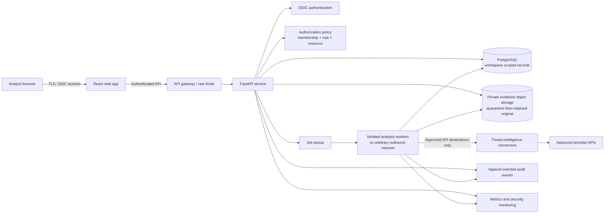

# OBSCURA Phase 3 — System Architecture and Threat Model

**Status:** Proposed architecture for review · **Date:** 2026-11-14
**Depends on:** [Phase 2 Product and Safety Requirements](../product/phase-2-product-and-safety-requirements.md)

## 1. Purpose and current state

This document proposes a first backend architecture for the Phase 2 requirements. It is a design artifact, not deployed infrastructure. The current GitHub Pages site remains a public static React/Vite preview with no authenticated backend or persistence.

The goal is a defensive, multi-workspace investigation service with clear evidence provenance and restricted analysis. The design keeps browser code, private evidence, analysis workers, and external intelligence providers in separate trust zones.

## 2. Proposed architecture

### Proposed technology choices

- **Web client:** existing React, TypeScript, and Vite app. Production console access requires authentication; the public landing page contains no secrets.
- **API:** Python FastAPI service, proposed to support future analysis workers and typed API contracts.
- **Authentication:** standards-based OIDC provider. Select a vendor only after tenant, region, MFA, session, and recovery requirements are decided.
- **Authorization:** a separate server-side policy layer that evaluates active account status, workspace membership, role, resource ownership, and requested operation on every request. Identity tokens establish account identity; they do not grant case access.
- **Primary database:** PostgreSQL for workspace metadata, cases, indicators, findings, job state, and audit references.
- **Evidence storage:** private object storage with encryption, versioning or immutable originals, and access mediated by the API.
- **Asynchronous work:** managed queue plus isolated worker containers for file parsing and engine jobs.
- **External intelligence:** server-side connector service with an explicit provider allowlist, per-source credentials, timeouts, and rate limits.
- **Operations:** centralized metrics and security events. Raw evidence and credentials are excluded from ordinary logs.

These choices are proposals. A cloud provider, service region, managed identity vendor, storage vendor, queue, budget, and retention policy remain undecided.

### Logical diagram

## 3. Trust boundaries and invariants

1. **Public internet to browser:** all public inputs and provider content are untrusted. The client cannot hold API secrets or make a decision about its own workspace authorization.
2. **Authentication boundary:** OIDC establishes the account identity and session. Session validity, MFA policy, account status, expiry, revocation, and recovery are checked independently of resource permissions.
3. **Authorization boundary:** the API asks a server-side policy layer whether this authenticated principal can perform this operation on this exact resource. Every read, write, export, and queued job repeats the relevant authorization check.
4. **API to storage/database/queue:** service credentials are separate, least-privilege, rotated, and never shipped to browser code. Database queries are workspace-scoped; defense-in-depth row-level policies may be used after application authorization is established.
5. **Queue to worker:** jobs contain identifiers and narrowly scoped instructions, not broad storage credentials. Workers receive only the case/evidence access needed for the job and have resource/time limits.
6. **Worker to internet:** arbitrary egress is denied. Only a connector with fixed, reviewed destinations may query Phase 7-approved provider APIs. User-supplied URL values never become fetch destinations.
7. **Evidence storage:** originals are immutable after intake or retained with versioned custody events. Derived outputs link back to the source hash and transformation.
8. **External providers:** only documented fields are sent; the provider and purpose are shown before processing. Provider results remain attributed, timestamped, and potentially fallible.

## 4. Initial data flow

1. Authenticate the analyst through OIDC; validate session, MFA policy, account state, expiry, and revocation.
2. Separately authorize the requested operation on the exact case/evidence/resource using server-side workspace membership, role, and ownership policy. Deny if any check is absent or ambiguous.
3. Create or authorize a case. Record the defensive purpose and validate the requested operation against the workspace policy.
4. For text indicators, normalize and defang display values; store an original representation only when necessary and permitted.
5. For an evidence file, enforce Phase 7 size/type/retention policy, calculate a SHA-256 digest at intake, write to private quarantine, and create a custody event.
6. Create a narrowly scoped queue job. The worker reads only the quarantined object through a temporary, least-privilege credential.
7. Parse supported metadata using sandboxed libraries with strict CPU, memory, file count, decompression, and wall-clock limits. Never execute files, macros, scripts, or embedded content.
8. Store derived outputs separately, tied to the original digest, engine/version, input IDs, source timestamps, individual check states, and result state.
9. The UI shows evidence lineage, supporting observations, stale/conflicting sources, and checks that could not be verified. A risk score is a ranking, not a probability unless calibration has been validated for a defined target.
10. An analyst or reviewer records the conclusion; the system does not silently convert a score into an external action.
11. Apply retention and deletion policy to primary records, derived files, caches, and backups. Record deletion events without retaining deleted evidence content.

## 5. Threat model

### Assets

- Case content, evidence files, notes, findings, and reports.
- Workspace membership, roles, identity sessions, and recovery paths.
- Provider API credentials and storage/queue/database service credentials.
- Original evidence integrity, custody events, and result provenance.
- Service availability, audit records, and model/dataset integrity in later phases.

### Threat actors

- An unauthenticated internet user probing the public site or API.
- A malicious or compromised workspace user attempting to exceed their role.
- An attacker submitting crafted URLs, documents, archives, media, or headers.
- A compromised provider, dependency, account, or CI/CD credential.
- A poisoning actor submitting false indicators or labels into future intelligence/model pipelines.
- An authorized insider misusing evidence access.

### Threats and required controls

| Threat | Example impact | Required design controls |
|---|---|---|
| Broken object-level authorization / IDOR | User reads or edits another workspace's case or evidence | Server-side membership and role checks on every request; workspace scoping in queries; negative cross-tenant tests; audit denied access |
| Account/session takeover | Unauthorized case access or report export | OIDC, MFA policy, secure session/token handling, short-lived recovery links, rate limits, revocation, and alerts for sensitive account changes |
| Authentication bypass or confused identity | Request is attributed to the wrong account or an expired/revoked session remains usable | Validate OIDC issuer, audience, signature, nonce/state, expiry and revocation/session state; separate identity proof from permissions; test expired, malformed, replayed, and disabled-account sessions |
| Malicious file or parser exploit | Worker compromise, data theft, or service outage | Quarantine, sandboxed non-root workers, no arbitrary egress, parser allowlist, resource caps, patched dependencies, temporary credentials, and disposal after each job |
| SSRF through user-supplied URL | Internal service access or cloud metadata disclosure | Never fetch submitted URLs; accept defanged text; fixed provider endpoints; egress firewall and DNS/IP validation at connector boundary |
| Archive/decompression bomb | Worker exhaustion or storage growth | Reject unsupported archives initially; set recursion, expansion, count, size, CPU, and wall-clock limits |
| Stored XSS / injection in evidence or provider data | Analyst session compromise or misleading findings | Treat all imported content as text; output encoding; restrictive CSP; validated rich-text policy; safe CSV/report export encoding |
| Cross-tenant query or cache leakage | Evidence or metadata disclosed across workspaces | Tenant-bound cache keys, database scoping, authorization before cache access, per-workspace storage prefixes, and isolation tests |
| Credential or evidence leakage in logs/build | Public disclosure of secrets or private evidence | Secret manager in deployment, CI secret scanning, redact request bodies, prohibit evidence logging, review build artifacts, and rotate suspected credentials |
| Provider compromise, outage, or bad data | Incorrect or unavailable findings | Provider allowlist and terms review, timeouts, circuit breaker, source attribution and age, explicit partial/unavailable results, independent corroboration |
| Poisoned indicators or model labels | Biased or adversarial prioritization | Source trust tiers, provenance, duplicate and label review, time-based evaluation, feedback quarantine, drift monitoring, rollback, and human review |
| Insider misuse | Sensitive evidence accessed without case need | Least privilege, separation of operator and analyst roles, audited break-glass access, access review, and documented incident response |
| Denial of service / cost exhaustion | Queue, API, storage, or provider limits exhausted | Per-user/workspace quotas, upload limits, bounded jobs, rate limiting, billing alerts, and administrator controls |
| Incomplete or unusable backups | Case or evidence loss after deletion, corruption, or provider outage | Define backup scope, encryption, access, frequency, retention, and recovery targets; restore into an isolated environment; verify counts, hashes, workspace isolation, and application readability; repeat drills and record results |
| Unsafe PHANTOM identity inference | False identification or biometric harm | Prohibit face recognition/biometric matching; limit features to approved brand/domain/text context; require human review and provenance |
| Incorrect cryptographic claim | False assurance from a hash/signature/proof screen | Deterministic vetted algorithms; key/context validation; explicit educational-demo labeling; no model-generated verification verdict |

## 6. Security and privacy requirements for implementation

- Use OWASP ASVS 5.0 as a requirements checklist for application and API controls, then document the verification level selected for the initial release.
- Map operational security work to NIST CSF 2.0 outcomes for Govern, Identify, Protect, Detect, Respond, and Recover.
- Use secure headers including a restrictive Content Security Policy, HSTS at the production host, and appropriate framing and MIME protections.
- Use parameterized database access, schema validation, request limits, output encoding, and explicit CORS origins.
- Do not grant browser JavaScript direct access to object storage or secret-bearing providers. Use short-lived, scoped transfer permissions only after server-side authorization.
- Encrypt evidence and backups with managed keys. Define key rotation and recovery before real evidence is accepted.
- Define recovery objectives and backup scope before live case storage. Before production evidence is accepted, restore a representative backup into an isolated environment and verify evidence hashes, case links, access isolation, and retention/deletion expectations. Repeat restore drills on a documented schedule.
- Maintain an append-oriented audit trail for authentication changes, case/evidence access, exports, provider lookups, retention actions, and privileged operations. Audit records must avoid storing evidence bodies.
- Keep rule-based GHOST and MIRAGE checks usable without an AI API. Any optional model adapter is isolated from baseline checks; provider unavailability must not erase or suppress rule results.
- Store findings as per-check records with input references, observations, source freshness, status, rule/model version, and unverified or conflicting checks. Do not label an uncalibrated priority score as a probability.
- Do not connect an external data feed until its Phase 7 source-governance record is approved.
- Keep public landing-page hosting separate from authenticated application and API origins when the production architecture is selected.
- Have a documented incident process for suspected cross-tenant access, evidence exposure, provider compromise, or poisoned data.

## 7. Security decision log

| Decision | Proposed default | Must be resolved before |
|---|---|---|
| Backend language | FastAPI/Python, matching future analysis tooling | Backend implementation |
| Tenant isolation | Workspace authorization on every request plus database scoping | Any multi-user case data |
| Evidence processing | Quarantine plus isolated short-lived workers | Any upload becomes active |
| Network access from workers | Deny by default; allow fixed provider API hosts through connectors | Any external lookup |
| Data region and hosting provider | Undecided | Real case data or customer accounts |
| Evidence retention and backup expiry | Undecided; no real upload until selected | Evidence storage |
| Authentication provider/MFA/recovery | OIDC; vendor and policy undecided | User accounts |
| Authorization policy | Separate workspace membership, roles, ownership, and action checks; detailed policy to be approved | Multi-user case access |
| Object storage, queue, and secret manager | Provider-neutral interfaces; vendor undecided | Deployment implementation |
| Backup/recovery objectives | Define RPO/RTO, backup retention, restore schedule, and recovery owner | Production case data |
| External data inventory | Terms, permissions, attribution, purpose, fields, freshness, retention, deletion | Any external ingestion |

## 8. Phase 3 completion criteria

- Phase 2 decisions that affect tenant boundaries, evidence handling, providers, and retention are resolved or explicitly deferred with a no-live-data gate.
- Authentication and authorization have distinct components, responsibilities, and validation plans.
- Every data flow and trust boundary has an owner and a required control.
- A backup and restore design includes a documented rehearsal gate before production evidence storage.
- Phase 7 data-governance approval is a hard dependency for Phase 8 connectors.
- A GHOST/MIRAGE MVP can save per-check, sourced results to a case using authorized representative inputs without any model API dependency.
- The threat table is converted into implementation requirements and security review items.
- A deployment diagram, secret inventory, data-retention plan, backup plan, and incident process exist before production data is accepted.
- No design path depends on opening suspicious URLs, executing attachments, face identification, or unreviewed model actions.

## References

- [NIST Cybersecurity Framework 2.0](https://www.nist.gov/cyberframework)
- [OWASP Application Security Verification Standard 5.0](https://asvs.owasp.org/)
- [NIST AI Risk Management Framework](https://airc.nist.gov/airmf-resources/airmf/5-sec-core/)
